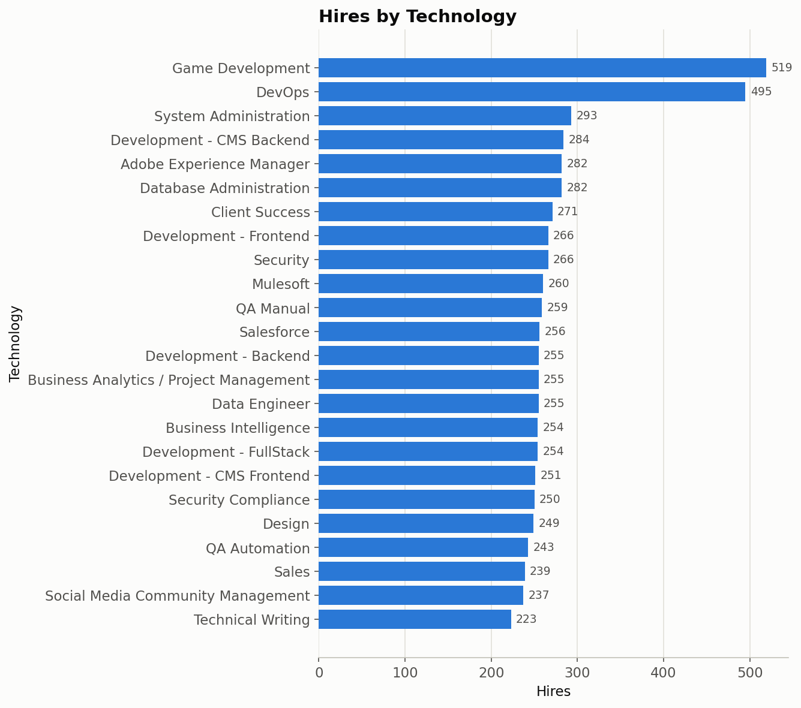
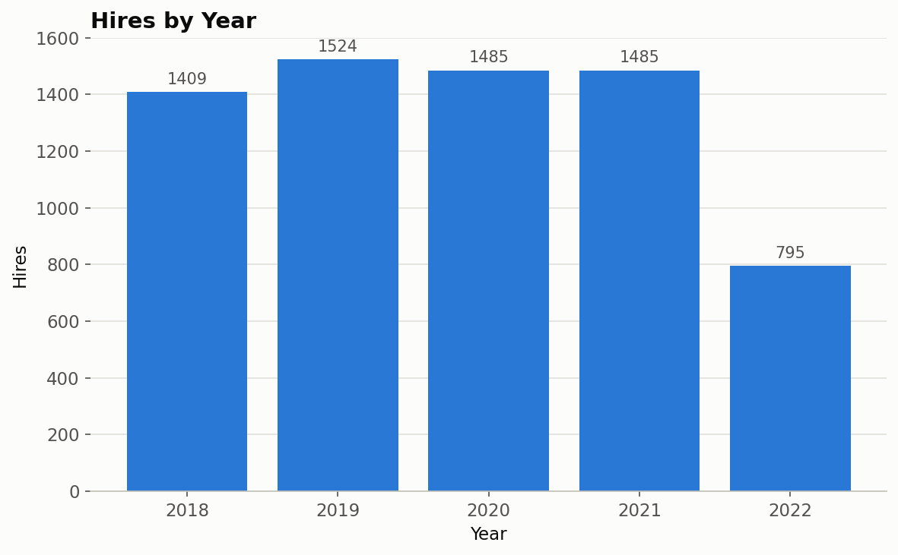
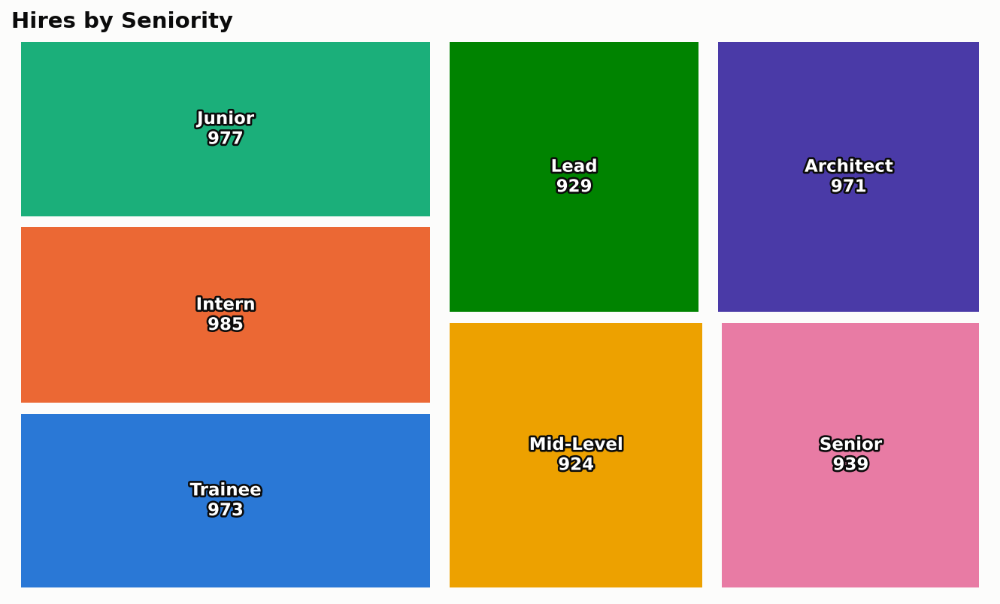
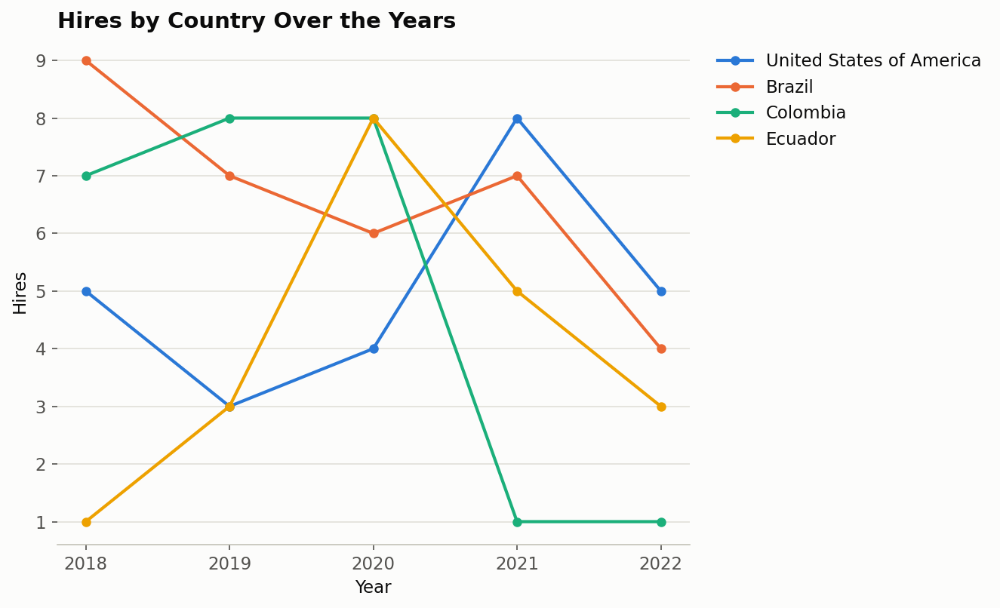

# Python Data Engineer Code Challenge

[](https://github.com/RAvellar13/etl-challenge/actions/workflows/ci.yml)


## About

Solution to a Python Data Engineer take-home challenge: load ~50k mock
candidate records from a CSV into a normalized relational (SQLite)
database via a hand-written ETL pipeline, then produce the required chart
visualizations from a Jupyter notebook that reads **only from the
database**, never from the CSV.

**Stack:** Python · pandas · SQLite · Jupyter · Matplotlib · pytest · GitHub Actions

## Charts

All four charts are built from SQL queries against `db/candidates.db` in
[`notebooks/analysis.ipynb`](notebooks/analysis.ipynb):

| Hires by Technology (horizontal bar) | Hires by Year (vertical bar) |
|---|---|
|  |  |

| Hires by Seniority (treemap) | Hires by Country Over the Years (multiline) |
|---|---|
|  |  |

## Project structure

```
.
├── .github/workflows/ci.yml    # lint-free CI: tests + ETL + notebook smoke test
├── data/
│   └── candidates.csv          # raw input (not modified)
├── db/
│   └── candidates.db           # generated by etl.py (gitignored, rebuilt on every run)
├── notebooks/
│   └── analysis.ipynb          # all 4 required charts, reads from db/candidates.db
├── tests/
│   └── test_etl.py             # pytest unit tests for the transform logic
├── etl.py                      # Extract -> Transform -> Load pipeline
├── build_notebook.py           # generates analysis.ipynb programmatically (dev tool, not required to run)
├── requirements.txt
├── requirements-dev.txt        # requirements.txt + pytest
├── LICENSE
└── README.md
```

## Setup

Requires Python 3.10+.

```bash
python -m venv venv
source venv/bin/activate        # Windows: venv\Scripts\activate
pip install -r requirements-dev.txt   # or requirements.txt if you don't need to run the tests
```

## Running the pipeline

1. **Run the ETL** — extracts `data/candidates.csv`, cleans/validates it,
   computes the hiring flag, and loads it into `db/candidates.db`:

   ```bash
   python etl.py
   ```

   Optional flags: `--csv <path>` and `--db <path>` to override the default
   locations.

2. **Run the notebook** — opens the database (never the CSV) and renders
   the four charts:

   ```bash
   jupyter notebook notebooks/analysis.ipynb
   ```

   Or execute it headlessly end-to-end:

   ```bash
   jupyter nbconvert --to notebook --execute --inplace notebooks/analysis.ipynb
   ```

   Chart PNGs are also saved alongside the notebook when it runs.

## Tests & CI

Unit tests cover the transform logic in isolation (hiring rule, date/score
validation, deduplication, derived columns) using small hand-built
DataFrames rather than the full CSV, so the suite runs in well under a
second:

```bash
pytest -v
```

GitHub Actions (`.github/workflows/ci.yml`) runs on every push/PR against
Python 3.10, 3.11 and 3.12: it installs dependencies, runs the test suite,
runs `etl.py` end-to-end, and executes the notebook as a smoke test.

## Data model

The ETL builds a small star-schema-style model in SQLite:

- `dim_country(country_id, country_name)`
- `dim_technology(technology_id, technology_name)`
- `dim_seniority(seniority_id, seniority_name, seniority_rank)` — `seniority_rank`
  gives a sensible ordering (Trainee → Architect) instead of alphabetical.
- `candidates(candidate_id, first_name, last_name, email, application_date,
  application_year, yoe, country_id, technology_id, seniority_id,
  code_challenge_score, technical_interview_score, is_hired)` — the fact table,
  one row per candidate, foreign-keyed to the three dimensions above.

Re-running `python etl.py` is idempotent: on every run it deletes any
existing database file at `--db` and rebuilds it from scratch (schema +
data) from the CSV. This is deliberate — `CREATE TABLE IF NOT EXISTS`
only skips creation when a table of that name already exists, it does not
check that its columns still match the current schema, so a full rebuild
is what guarantees the database is never left with a stale/partial schema
from an earlier run or an older version of the script.

## Business rule: "hired"

The source data has no explicit `Hired` column. Following the challenge's
own scoring fields, a candidate is considered **hired** when:

```
Code Challenge Score >= 7  AND  Technical Interview Score >= 7
```

(both scores are on a 0–10 scale). This yields 6,698 hires out of 50,000
candidates (~13.4%), computed in `etl.py::transform()` as the `Is Hired`
column and persisted as `candidates.is_hired`.

## Cleaning/validation performed

- Trims whitespace on text fields; lower-cases emails.
- Parses `Application Date`; drops rows where it can't be parsed.
- Coerces YOE and scores to numeric; drops rows with invalid values.
- Clips scores to the documented 0–10 range and YOE to non-negative.
- Removes exact duplicate rows.
- Derives `Application Year` and the `Is Hired` flag.

## License

[MIT](LICENSE)
